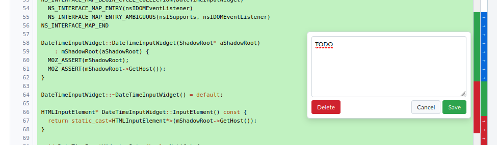
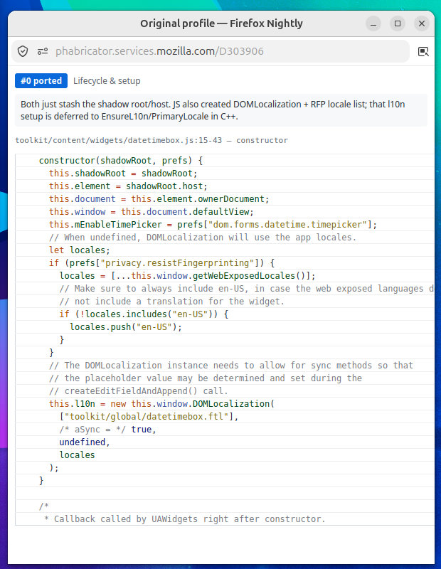

# PhabLens

Firefox extension for Phabricator code review on `phabricator.services.mozilla.com`.

## Features



### Comment Permalinks
Each inline review comment gets a `#<id>` link (e.g. `#1641595`). Click to jump to it, or right-click → copy link for a shareable permalink.

### Floating latest diff / interdiff button
The lower right has a floating button to quickly get to
- the latest diff if on an interdiff or older diff
- the latest interdiff otherwise

### Line-Level Review Tracking
A narrow gutter column on each diff line lets you track review progress locally:

- **Click** a line to mark it reviewed (green). Click again to flag it (red). Click again to clear.
- **Click and drag** across multiple lines to mark a range at once.
- **Right-click** to attach a local note.
- A floating badge shows `N/M reviewed` progress. **Click the badge** to jump to the first line of the next unmarked block. After 30 seconds without a badge click, the next click restarts at the first unmarked block again.

Review state is stored per revision and diff in `browser.storage.local`. Interdiffs (`?vs=X&id=Y`) are tracked separately.

### Annotation Mapping
Load a JSON mapping file to visualize how code moved between files in a large refactoring diff. Useful when porting JS to C++, splitting/merging modules, etc.

- Click the **PhabLens** toolbar icon to open the annotation panel, then **Load JSON**.
- A second gutter column appears. Each annotation gets its own color from a cycling palette, so adjacent blocks are always visually distinct.
- **Hover** any colored cell to see its index, category, and comment.
- **Click** a linked annotation (ported/inlined/merged/split) to scroll to the counterpart in the diff.
- Supported categories: `ported`, `new`, `inlined`, `removed`, `merged`, `split`.
- Annotations are session-only (cleared on page reload). Collapsed files are handled — the gutter appears when the file is expanded.

#### Mapping file format

```json
{
  "$schema": "./schemas/annotation-mapping.schema.json",
  "annotations": [
    {
      "category": "ported",
      "group": "Lifecycle & setup",
      "from": { "file": "browser/foo.js", "lines": [10, 25], "name": "setup" },
      "to": { "file": "dom/Bar.cpp", "lines": [42, 57], "name": "Setup" },
      "comment": "Core logic moved to native impl"
    }
  ]
}
```

The field contract and descriptions are documented in `schemas/annotation-mapping.schema.json`.
For agents creating these files, see [the annotation skill](skills/phablens-annotation/SKILL.md).

### Annotation Lens (Picture-in-Picture)



Open a floating lens window that shows annotation details as you hover over the gutter.

- In the annotation panel, click **Open Lens** to pop out a Document Picture-in-Picture window.
- **Hover** any annotation cell — the lens updates with the annotation's category, comment, and the corresponding source code cloned from the diff.
- For linked annotations (ported/inlined/merged/split), the lens shows the counterpart code (hover `from` → see `to`, and vice versa).
- For unlinked annotations (removed, new), the lens shows whichever side exists.

Requires Firefox flag `dom.pictureInPictureAPI.documentEnabled` in `about:config`. The button is hidden when the API is unavailable.

## Install

This is a plain JavaScript Firefox extension with no build step. Load the repository as a temporary extension from `about:debugging` → **This Firefox** → **Load Temporary Add-on…**, then select `manifest.json`. Review tracking is saved locally; annotation mappings are cleared when the page reloads.

## Publish to Firefox

Create an upload-ready package from the repository root:

```sh
python3 scripts/package-firefox.py
```

The script writes `artifacts/phablens-<version>-firefox.zip`. It includes `manifest.json` and the runtime files in `src/`; there is no build step. The package is also accepted with its `.zip` extension by AMO.

To publish it publicly, sign in to [addons.mozilla.org](https://addons.mozilla.org/), open the [Add-on Developer Hub](https://addons.mozilla.org/developers/), and choose **Submit a New Add-on** → **On this site**. Upload the ZIP, address any validator errors, fill in the listing details, and submit. Firefox will deliver future listed updates automatically; upload each new version from the add-on's existing Developer Hub page.

To share it without a public listing, choose **On your own** instead. Upload the ZIP for signing, then download the signed XPI from the submission page and share or host that file. Firefox still requires Mozilla's signature for regular releases. Increment `version` in `manifest.json` for each release. Mozilla may review submissions, and minified, bundled, or generated code can require a source-code submission; this extension currently ships readable source directly.
